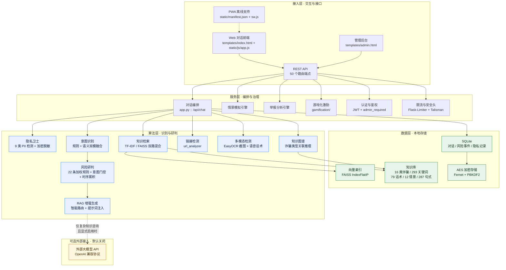
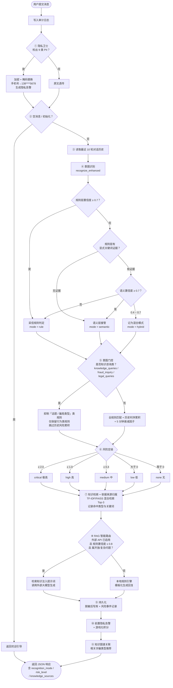
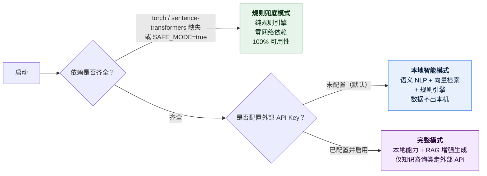
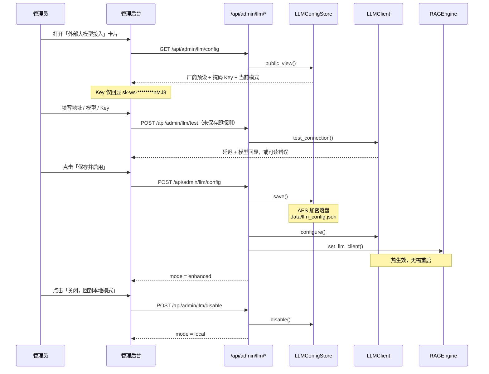

# 附录

> 本文档为「反诈卫士 v3.0」参赛材料的第六部分，覆盖软件设计资料、核心代码、测试数据、参考文献与其他补充材料。
>
> **全部量化指标均取自本仓库 `evaluation/results/` 下的实测报告**，采样口径与样本量警示随文标注；凡指标存在多版本差异处，均标明出处报告与测试时间，不做合并或择优。

---

## 一、软件设计资料

### 1.1 系统总体架构

系统采用**分层解耦 + 可降级**架构。自下而上分为数据层、算法层、服务层、接入层四层，配套贯穿全层的质量保障体系。



**架构要点说明：**

| 设计要点 | 说明 | 对应代码 |
|---|---|---|
| **分层解耦** | 算法层不依赖 Flask，可脱离 Web 框架单独导入测试；`engine/` 下 19 个模块互不持有全局 Web 状态 | `engine/*.py` |
| **可选外部接入** | 外部大模型是**旁路而非主干**：关闭时（默认）系统功能完整，开启后仅接管"复杂知识咨询"一类请求 | `engine/llm_config_store.py`、`engine/rag_engine.py` |
| **数据不出本机** | 默认配置下无任何外部网络调用；语义模型本地加载（`NLP_OFFLINE_MODE=true`），检索、研判、生成全在进程内完成 | `config.py`、`engine/nlp_encoder.py` |
| **降级不中断** | 三档运行模式（见 1.4），任一组件缺失都不影响主对话可用 | `app.py :: /api/health` |

### 1.2 核心链路流程图：`POST /api/chat`



**流程设计的关键取舍：**

1. **隐私先于识别（步骤 ①→④）**——PII 在任何算法处理之前就被替换，因此后续的意图识别、风险研判、日志落库、乃至（开启时的）外部大模型调用，看到的都已是脱敏文本。原文仅以密文形式存于本机。
2. **双模融合的保守阈值（步骤 ④）**——规则层置信度公式为 `匹配数 ÷ 关键词总数 × 1.5`，天然偏低（实测 0.2~0.4）。若按"语义置信度 > 规则置信度"就覆盖，短文本噪声会让语义层用 `emergency` / `greetings` 等低信息意图覆盖掉正确的知识查询判定。故引入**证据强度门控**：规则层有显式关键词命中时，语义层需 ≥ 0.7 才可覆盖。
3. **意图门控抑制误报（步骤 ⑤）**——"给我讲讲刷单诈骗"这类纯知识咨询，若不加门控会因命中"刷单""转账"等词而被判高危。门控在意图为知识咨询类时抑制"话题/骗局类型"规则（保留"转账到陌生账户"等行为类规则），并跳过历史风险累积。
4. **本地优先的路由（步骤 ⑧）**——规则置信度 > 0.8 时直接用规则引擎，不调外部 API。这既是延迟考量，也保证**紧急劝阻场景不被网络往返拖慢**。

### 1.3 模块清单

| 层次 | 模块 | 文件 | 行数 | 职责 |
|---|---|---|---|---|
| 服务层 | 应用主程序 | `app.py` | 1,625 | 50 个路由、对话编排、鉴权、限流、审计 |
| 算法层 | 响应生成器 | `engine/response_generator.py` | 1,207 | 意图→回复编排、知识来源归属 |
| 算法层 | 意图识别 | `engine/intent_recognizer.py` | 463 | 加权规则、同义词扩展、上下文状态机、双模融合 |
| 算法层 | 风险研判 | `engine/risk_analyzer.py` | 596 | 22 条加权规则、意图门控、时序累积、干预话术 |
| 算法层 | 知识检索 | `engine/knowledge_retriever.py` | 403 | TF-IDF 索引、语义检索、法条/问答检索 |
| 算法层 | 向量检索 | `engine/vector_search.py` | 240 | FAISS 索引构建与混合检索融合 |
| 算法层 | 语义分类 | `engine/intent_classifier.py` | 224 | 15 类零样本意图锚点、诈骗类型打分 |
| 算法层 | 语义编码 | `engine/nlp_encoder.py` | 144 | 预训练模型加载、向量编码、离线保障 |
| 算法层 | NLP 管道 | `engine/nlp_pipeline.py` | — | 组件装配与就绪探测 |
| 算法层 | RAG 引擎 | `engine/rag_engine.py` | 260 | 知识注入、智能路由、流式生成 |
| 算法层 | 大模型客户端 | `engine/llm_client.py` | — | OpenAI 兼容协议、5 家厂商预设、URL 归一化 |
| 算法层 | 接入配置存储 | `engine/llm_config_store.py` | 230 | 运行时热切换、API Key 加密落盘与掩码回显 |
| 算法层 | 隐私卫士 | `engine/privacy_guard.py` | 618 | 9 类 PII 检测、会话级加密、脱敏与告警 |
| 算法层 | 多模态检测 | `engine/multimodal_detector.py` | 413 | EasyOCR 截图识别、语音话术分析 |
| 算法层 | 链接检测 | `engine/url_analyzer.py` | — | URL 特征提取与风险打分 |
| 算法层 | 知识图谱 | `engine/knowledge_graph.py` | — | 诈骗类型关联推理 |
| 算法层 | 安全基座 | `engine/security.py` | 686 | AES 加密、JWT 认证、密码哈希、脱敏 |
| 数据层 | 数据访问 | `engine/database.py` | — | SQLite ORM、隐私安全读写接口 |
| 激励层 | 游戏化系统 | `gamification/gamification.py` | 552 | 积分、勋章、排行榜 |
| 质量层 | 测试套件 | `tests/test_*.py`（9 个） | 928 | 119 个测试用例 |
| 质量层 | 评测脚本 | `evaluation/`（5 个） | 1,299 | 意图/类型/风险/性能/消融评测 |

**代码规模合计：49 个 Python 文件、15,373 行**（不含 `.venv`、缓存与生成物）。

### 1.4 三档运行模式（降级设计）

系统在依赖缺失或配置受限时自动降级，**任一档位下主对话均可正常使用**：



| 档位 | 触发条件 | 具备能力 | 网络依赖 |
|---|---|---|---|
| 完整模式 | 依赖齐全 + 外部 API 已配置并启用 | 本地全部能力 + RAG 增强生成 | 仅知识咨询类请求 |
| **本地智能模式（默认）** | 依赖齐全 + 未配置 API Key | 语义 NLP + 向量检索 + 规则引擎 | **零网络** |
| 规则兜底模式 | 依赖缺失 或 `SAFE_MODE=true` | 纯规则引擎 | **零网络** |

> 系统的**默认出厂状态是本地智能模式**，必须由用户在管理后台显式填写并启用外部 API 才会进入完整模式。这是隐私与可审计性优先的设计选择，而非能力缺失。

### 1.5 运行时配置入口（外部大模型接入）

外部大模型接入被设计为**运行时可配置项**，而非编译期写死的依赖：



**设计约束：**

- API Key 经 AES 加密后落盘（`data/llm_config.json`），对外接口**只回显掩码**，明文仅存在于进程内存与真实调用时；
- 配置存储加 `threading.RLock` 保护（Flask 默认 `threaded=True`），落盘采用「临时文件 + `os.replace`」原子替换，避免写一半崩溃损坏配置；
- RAG 引擎与 Flask 应用**共用同一个 `LLMClient` 实例**（通过 `set_llm_client()` 注入），否则热切换后会出现"后台显示已启用、RAG 仍走规则"的状态不一致；
- 未配置 `ADMIN_PASSWORD_HASH` 时 `admin_required` 放行（本地演示模式），一旦设定密码即转为严格管理员令牌校验。

---

## 二、核心代码

> 以下代码摘自项目实际实现，注释保留原有中文说明。完整源码见提交的工程目录。

### 2.1 意图门控的风险研判（可申请专利技术点 A）

**问题背景：** 传统反诈规则引擎对"给我讲讲刷单诈骗"这类**纯知识咨询**会因命中"刷单""转账"等词而误判高危。本项目在风险研判前引入**意图门控**——按意图类别决定启用哪些规则。

`engine/risk_analyzer.py`：

```python
class RiskAnalyzer:
    # 知识咨询类意图：用户是在"问知识"，不是在"描述遭遇"
    KNOWLEDGE_INTENTS = {"knowledge_queries", "fraud_inquiry", "legal_queries"}

    def analyze_risk(self, user_input: str, user_id: str = "default",
                     dialog_history: list = None, intent: str = None) -> dict:
        if not user_input:
            return {"risk_level": "none", "risk_score": 0, "triggered_rules": []}

        # 知识咨询意图门控
        knowledge_mode = intent in self.KNOWLEDGE_INTENTS
        triggered, total_score = [], 0

        # 1. 当前输入匹配规则
        for rule_name, rule in self.RISK_RULES.items():
            if knowledge_mode and rule_name not in self.ACTION_RULES:
                continue  # 知识咨询下抑制"话题类"规则，仅保留"行为类"规则
            for pattern in rule["patterns"]:
                if re.search(pattern, user_input):
                    triggered.append({
                        "rule": rule_name, "category": rule["category"],
                        "weight": round(rule["weight"], 2),
                        "intervention_type": rule.get("intervention", ""),
                        "from_history": False
                    })
                    total_score += rule["weight"]
                    break

        # 2. 对话历史分析（时序累积）
        #    知识咨询意图下跳过：用户是在"问知识"，历史中的风险词不应叠加到本次咨询上
        if dialog_history and not knowledge_mode:
            history_text = " ".join(dialog_history[-6:])
            for rule_name, rule in self.RISK_RULES.items():
                for pattern in rule["patterns"]:
                    if re.search(pattern, history_text):
                        matched_in_current = rule_name in [t["rule"] for t in triggered]
                        if not matched_in_current:
                            # 历史命中按 0.5 折价
                            triggered.append({..., "weight": round(rule["weight"] * 0.5, 2),
                                              "from_history": True})
                            total_score += rule["weight"] * 0.5
                        else:
                            # 历史中多次出现 → 风险累加
                            occurrence = len(re.findall(pattern, history_text))
                            if occurrence > 1:
                                total_score += rule["weight"] * 0.2
                        break

        # 3. 最近历史风险衰减（5 分钟窗口，衰减因子 0.1）
        if (not knowledge_mode) and user_id in self.risk_history:
            for event in self.risk_history[user_id][-5:]:
                if time.time() - event.get("timestamp", time.time()) < 300:
                    total_score += event.get("score", 0) * 0.1

        # 4. 风险等级判定（动态阈值）
        risk_level = "none"
        if total_score >= 2.0:   risk_level = "critical"
        elif total_score >= 1.0: risk_level = "high"
        elif total_score >= 0.4: risk_level = "medium"
        elif total_score > 0:    risk_level = "low"
        ...
```

**与时序累积的完整评分公式：**

```
score = Σ w_rule(当前命中)
      + Σ 0.5 · w_rule(历史命中，且当前未命中)
      + Σ 0.2 · w_rule(历史多次出现)
      + Σ 0.1 · score(近 5 分钟内的历史事件)

等级：≥2.0 极高 | ≥1.0 高 | ≥0.4 中 | >0 低
```

### 2.2 规则证据强度门控的双模融合（可申请专利技术点 C）

**问题背景：** "规则优先、语义兜底"是常见做法，但**如何决定语义层何时可以覆盖规则层**缺乏依据。本项目的方案是按**规则层的证据强度**设定覆盖阈值。

`engine/intent_recognizer.py :: recognize_enhanced()`：

```python
def recognize_enhanced(self, text, user_id="default", dialog_history=None) -> dict:
    """规则引擎做首轮快速匹配（高精度），语义分类做兜底（高召回），两者融合输出。"""
    # 1. 先用规则引擎
    rule_result = self.recognize(text, user_id, dialog_history)

    # 2. 规则引擎高置信度 → 直接返回
    if rule_result["confidence"] >= 0.7:
        rule_result["recognition_mode"] = "rule"
        return rule_result

    # 3. 语义增强
    classifier = get_intent_classifier()
    if classifier.ready:
        sem_intent, sem_conf = classifier.classify_top1(text, min_confidence=0.35)
        mapped_intent = intent_map.get(sem_intent, sem_intent)

        rule_conf = rule_result.get("confidence", 0)
        rule_matched = bool(rule_result.get("matched_keywords"))

        # 融合策略（v3.0-P1 修正）：
        # 规则层有**显式关键词证据**时，视为高精度判断，只有语义高度自信
        # (>=0.7) 才允许覆盖；否则保留规则判定。
        # 原因：规则置信度公式为 匹配数/关键词总数*1.5，天然偏低（0.2~0.4），
        # 若按 "sem_conf > rule_conf" 就覆盖，几乎总被语义层（短文本噪声大）
        # 用 emergency/greetings 等低信息意图覆盖掉正确的知识查询判定。
        # 规则层无任何证据时，语义层作为兜底直接接管。
        sem_can_override = (sem_conf >= 0.7) or (not rule_matched)

        if sem_can_override and sem_conf > rule_conf:
            rule_result["intent"] = mapped_intent
            rule_result["confidence"] = sem_conf
            rule_result["recognition_mode"] = "semantic"
        elif sem_conf > 0.4:
            rule_result["recognition_mode"] = "hybrid"   # 未达覆盖阈值，记为混合模式
```

**覆盖阈值语义：**

| 规则层状态 | 语义层置信度 | 结果 |
|---|---|---|
| 有显式关键词证据 | ≥ 0.7 | 语义覆盖（`semantic`） |
| 有显式关键词证据 | 0.4 ~ 0.7 | 保留规则判定，标记 `hybrid` |
| 有显式关键词证据 | < 0.4 | 保留规则判定 |
| **无任何证据** | 任意 | **语义层接管**（兜底） |

### 2.3 敏感信息检测—加密脱敏—反向告警（可申请专利技术点 B）

**问题背景：** 用户求助时往往主动提供手机号、身份证号、银行卡号。常规做法是"存下来"，本项目将其转化为**服务用户的信号**：检测 → 加密脱敏 → **反向提醒用户"你刚才泄露了敏感信息"**。

`app.py :: chat()` 中隐私处理先于一切算法：

```python
# ========== 隐私保护: 检测并加密PII（在任何算法处理之前）==========
privacy_alerts = []
privacy_clean_input = user_input
has_privacy_alert = False

if user_id not in privacy_sessions:
    privacy_sessions[user_id] = privacy_guard.create_session(f"user_{user_id}")
privacy_session_id = privacy_sessions[user_id]

if user_input and user_input != '__init__':
    pii_result = privacy_guard.detect_and_protect(user_input, privacy_session_id, user_id)
    if pii_result.has_pii:
        privacy_alerts = pii_result.alert_messages
        privacy_clean_input = pii_result.clean_text       # 脱敏文本供后续处理
        has_privacy_alert = True
        audit("PRIVACY_DETECTED", {...}, "warning")

# 后续所有处理均使用脱敏文本 —— 意图识别、风险研判、落库、外部API调用
response_data = response_gen.generate_response_enhanced(privacy_clean_input, user_id, ...)
```

`engine/privacy_guard.py` 检测规则（9 类 PII）：

```python
# 中国大陆手机号: 1开头的11位数字（前后不能再接数字，避免误切长数字串）
PHONE_PATTERN = re.compile(r'(?<!\d)1[3-9]\d{9}(?!\d)')
# 身份证号: 17位数字 + 1位数字或X
# 银行卡号 / 中文姓名（结合上下文）/ 家庭地址 / 微信号 / QQ号 / 短信验证码 / 密码
```

**加密与存储：**

- 每会话独立密钥：`session_key = SHA256(master_key : session_id : random)`，会话隔离，跨会话密文不可互解；
- 原文仅以密文形式落库（`save_privacy_record`），展示层只得掩码 `138****5678`；
- 会话关闭后自动清除隐私数据；`DATA_RETENTION_DAYS` 默认 90 天。

### 2.4 本地知识检索 + 依据来源归属（默认模式的核心）

**设计目标：** 即使**完全不接外部大模型**，系统也必须能给出可追溯、可解释的回答——即"这条结论是查了知识库哪几条得到的"。

`engine/response_generator.py`：

```python
def _build_knowledge_sources(self, user_input: str, top_k: int = 3) -> dict:
    """
    生成「依据来源」归属信息 —— 回答"这条结论是查了知识库哪几条得到的"。
    纯本地检索，不依赖 LLM：即使外部 API 关着（默认的本地模式）也能用。
    """
    try:
        results = self.knowledge_retriever.semantic_search(user_input, top_k=top_k)
    except Exception:
        return {}
    if not results:
        return {}

    matched = []
    for r in results:
        fid = r.get("fraud_id", "")
        item = {
            "id": fid,
            "score": round(float(r.get("similarity", 0) or 0), 4),
            "match_type": r.get("match_type", "keyword"),
            "risk_level": r.get("risk_level", ""),
        }
        # 关键词命中项便于"为什么匹配上"的解释
        fraud = self.knowledge_retriever.get_fraud_by_id(fid)
        if fraud:
            hit = [kw for kw in fraud.get("keywords", []) if kw and kw in user_input]
            if hit:
                item["hit_keywords"] = hit[:5]
        matched.append(item)

    return {
        "matched_fraud_types": matched,
        # score 是「本次检索内归一化」的相对匹配度（Top-1 恒为 1.0），不是绝对置信度
        "score_type": "relative",
        "retrieval_mode": matched[0].get("match_type", "keyword") if matched else "",
        "source": "本地知识库（16 类诈骗 / 293 关键词 / 79 话术模板）",
    }
```

**实测响应片段**（本地模式，未接任何外部 API）：

```json
{
  "recognition_mode": "rule",
  "risk_level": "high",
  "fraud_type": "刷单返利",
  "knowledge_sources": {
    "matched_fraud_types": [
      {"id": "虚假投资", "score": 1.0, "match_type": "keyword",
       "hit_keywords": ["返利"], "risk_level": "critical"},
      {"id": "刷单返利", "score": 0.74, "match_type": "semantic",
       "hit_keywords": ["刷单", "兼职", "返利", "任务"], "risk_level": "high"},
      {"id": "冒充熟人", "score": 0.54, "match_type": "semantic",
       "hit_keywords": ["垫付"], "risk_level": "high"}
    ],
    "score_type": "relative",
    "retrieval_mode": "keyword",
    "source": "本地知识库（16 类诈骗 / 293 关键词 / 79 话术模板）"
  }
}
```

### 2.5 混合检索的分数归一化（一处实测缺陷的修复）

**发现过程：** 在实现依据来源归属时，实测发现检索返回的分数出现 `1.6`（即"匹配度 160%"）这一不可能的余弦值。

**根因：** 混合检索融合了两路**量纲不同**的分数——语义路是 FAISS 内积/余弦（0~1），关键词路是累加命中分（每命中关键词 +2、别名 +1、模式 +0.5，**上不封顶**）。不归一化就直接加权合并，关键词路会凭量纲碾压语义路，且越界数值被 `f"{score:.0%}"` 格式化后作为 "匹配度: 160%" 写进了 RAG 提示词。

**修复**（`engine/vector_search.py`）：

```python
@staticmethod
def _normalize(scores: List[float]) -> List[float]:
    """把一路检索的原始分线性压到 [0,1]（除以该路最高分）。"""
    if not scores:
        return []
    top = max(scores)
    if top <= 0:
        return [0.0] * len(scores)
    return [s / top for s in scores]

def hybrid_search(self, query: str, top_k: int = 3) -> List[Dict]:
    """混合检索：语义 + 关键词，各自归一化后加权融合重排"""
    semantic_results = self.search(query, top_k=top_k * 2)
    keyword_results = self._keyword_fallback(query, top_k=top_k)

    norm_sem = self._normalize([r.get("_score", 0) for r in semantic_results])
    norm_kw  = self._normalize([r.get("_score", 0) for r in keyword_results])

    seen_ids, merged = set(), []
    for r, s in zip(semantic_results, norm_sem):
        if r["id"] not in seen_ids:
            r["_raw_score"] = r.get("_score", 0)
            # _score 对外只表示"该路归一化匹配度"，恒在 [0,1]，可直接当百分比展示；
            # 权重只进 _rank_score 参与排序，不污染对外数值（否则会出现 120%）
            r["_score"] = round(s, 4)
            r["_rank_score"] = s * 1.2          # 语义权重略高
            merged.append(r); seen_ids.add(r["id"])
    for r, s in zip(keyword_results, norm_kw):
        if r["id"] not in seen_ids:
            r["_raw_score"] = r.get("_score", 0)
            r["_score"] = round(s, 4)
            r["_rank_score"] = s * 0.8
            merged.append(r); seen_ids.add(r["id"])

    merged.sort(key=lambda x: x["_rank_score"], reverse=True)
    return merged[:top_k]
```

**修复效果（同一批查询实测对比）：**

| 查询 | 修复前 Top-1 | 修复后 Top-1 | 说明 |
|---|---|---|---|
| 刷单兼职说做任务返利，先垫付一点可以吗 | 虚假投资（错误） | **刷单返利（正确）** | 关键词量纲碾压语义路被消除 |
| 我接到电话说我涉嫌洗钱，让我把钱转到安全账户 | 冒充熟人 | 冒充熟人 → **冒充公检法升至第 2** | 排序更合理 |
| FaceTime客服说百万保障到期 | FaceTime诈骗（正确） | FaceTime诈骗（正确） | 无回归 |
| 视频通话里是我女儿吗还是AI合成的 | AI换脸诈骗（正确） | AI换脸诈骗（正确） | 无回归 |

同时，对外分数全部落在 `[0, 1]`（越界项 0 个），RAG 提示词中的百分比不再越界，并改标注为"**相对**匹配度"，避免模型把相对值当成绝对概率。

### 2.6 外部大模型接入的运行时热切换

`engine/llm_config_store.py`：

```python
class LLMConfigStore:
    """外部大模型接入配置的持久化与读取。线程安全。"""

    def __init__(self, path: str, encryptor=None):
        self._path = path
        self._encryptor = encryptor
        # RLock：save()/disable() 持有锁后还会调用 load()，用普通 Lock 会自锁死
        self._lock = threading.RLock()
        self._cache: Optional[dict] = None

    def public_view(self) -> dict:
        """对外安全视图：Key 只回显掩码，供 /api/admin/llm/config 使用"""
        cfg = self.load()
        view = {k: v for k, v in cfg.items() if k != "api_key"}
        view["api_key_masked"] = mask_api_key(cfg.get("api_key", ""))
        view["has_api_key"] = bool(cfg.get("api_key"))
        return view

    def _write(self, cfg: dict) -> None:
        """落盘。Key 加密；其余字段明文（不含敏感信息）"""
        api_key = cfg.pop("api_key", "")
        payload = dict(cfg)
        if api_key:
            if not self._encryptor:
                raise RuntimeError("加密器不可用，拒绝以明文形式存储 API Key")
            payload["api_key_enc"] = self._encryptor.encrypt_json({"api_key": api_key})
        else:
            payload["api_key_enc"] = ""

        os.makedirs(os.path.dirname(self._path), exist_ok=True)
        # 先写临时文件再替换，避免写一半崩溃导致配置损坏
        tmp = self._path + ".tmp"
        with open(tmp, "w", encoding="utf-8") as f:
            json.dump(payload, f, ensure_ascii=False, indent=2)
        os.replace(tmp, self._path)
```

`engine/llm_client.py` —— API 地址归一化（修复了一处既存缺陷：`.env.example` 提供的是**基础地址**，而旧代码直接将其当作 POST 全地址使用）：

```python
def normalize_api_url(api_url: str) -> str:
    """
    兼容"基础地址"与"完整端点"两种写法。
    例：https://api.deepseek.com/v1 → https://api.deepseek.com/v1/chat/completions
    """
    url = (api_url or "").strip().rstrip("/")
    if not url:
        return url
    if url.endswith("/chat/completions"):
        return url
    if url.endswith("/v1") or "/compatible-mode" in url:
        return url + "/chat/completions"
    if "://" in url and url.count("/") == 2:
        return url + "/v1/chat/completions"
    return url
```

`engine/rag_engine.py` —— 共用同一客户端，避免热切换后状态不一致：

```python
def set_llm_client(self, client) -> None:
    """
    注入外部 LLM 客户端。
    用于让 RAG 与 Flask 应用共用同一个实例 —— 否则两边各自持有一个
    LLMClient，管理后台热切换配置时只会刷新其中一个，出现「后台显示已启用、
    RAG 却仍走规则」的不一致。
    """
    self._llm_client = client
```

### 2.7 管理后台的降级鉴权

`app.py`：

```python
def admin_required(f):
    """
    管理员认证装饰器。
    降级策略：未配置 ADMIN_PASSWORD_HASH 时放行（本地演示/单机模式）。
    若一上来就强制鉴权，而默认配置里根本没有可用的管理员密码，
    用户将永远进不去管理后台。一旦通过 .env 或 /api/admin/set-password
    设定了密码，这里即转为严格校验管理员令牌。
    """
    @wraps(f)
    def decorated(*args, **kwargs):
        if not Config.ADMIN_PASSWORD_HASH:
            request.user = {"user_id": "local-admin", "role": "admin"}
            return f(*args, **kwargs)
        token = request.headers.get('Authorization', '').replace('Bearer ', '')
        payload = jwt_auth.verify_token(token) if token else None
        if not payload or payload.get("role") != "admin":
            return jsonify({"error": "需要管理员权限"}), 403
        request.user = payload
        return f(*args, **kwargs)
    return decorated
```

### 2.8 配置加载顺序缺陷的修复（一处既存 bug）

`config.py` 原将 `load_dotenv()` 放在文件**末尾**（第 96 行），而 `Config` 类体（第 10–93 行）中的 `os.getenv()` 在 `import` 时即已求值完毕——导致 `.env` 文件**完全失效**。实测验证：`.env` 中写入 `PORT=19999`、`LLM_ENABLED=true` 后，`Config.PORT` 仍读到 `5000`、`Config.LLM_ENABLED` 仍为 `False`。

```python
import os
from pathlib import Path

BASE_DIR = Path(os.path.dirname(os.path.abspath(__file__)))

# ⚠️ 必须在 Config 类体求值「之前」加载 .env。
# 类体里的 os.getenv() 是在 import 时立即执行的，若把 load_dotenv 放在文件末尾，
# 所有默认值都会先于 .env 被写死，导致 .env 完全失效（历史 bug）。
_DOTENV_LOADED = False
try:
    from dotenv import load_dotenv
    # override=False：真实环境变量优先级仍高于 .env，与下方 Config 注释的优先级一致
    _DOTENV_LOADED = load_dotenv(BASE_DIR / '.env')
except ImportError:  # python-dotenv 为可选依赖
    pass

class Config:
    ...
```

修复后实测：`.env` 中的 `PORT` / `LLM_ENABLED` / `LLM_MODEL` 均正确生效。

---

## 三、测试数据

### 3.1 性能基准

**出处：** `evaluation/results/benchmark_report.md` / `.json`
**测试时间：** 2026-10-10 09:17:30　**测试环境：** Windows / Python 3.11 / **CPU 推理**（无 GPU 加速）

| 指标 | 实测值 | 说明 |
|---|---|---|
| 语义模型加载 | 10.269 s | 首次加载，之后常驻内存 |
| 单条文本编码延迟 | 30.44 ms | P95 73.96 ms |
| 批量编码吞吐 | 344.9 条/秒 | 批量 64 条耗时 185.58 ms |
| 向量检索延迟 | 64.6 ms | FAISS Top-3 |
| 端到端响应延迟 | 2.23 ms | P95 1.81 ms（原文如此） |
| 单线程吞吐 | 448.4 QPS | 意图 + 风险 + 检索 + 生成全链路 |

> **口径说明：** 上表端到端延迟与 QPS 为**规则引擎路径**的实测值（不含外部大模型网络往返）。语义模型加载 10.269 s 为首帧成本，部署时建议服务启动后预热一次（见 `docs/部署指南.md`）。

### 3.2 消融实验

**出处：** `evaluation/results/ablation_report.md` / `.json`　**实验时间：** 2026-10-10 09:17
**实验目的（原文）：** 验证「规则 + 语义」融合方案相对于单一策略的增益

**实验一：意图识别**（评测集 `intent_eval.json`，70 条 / 14 类）

| 策略 | 准确率 | 正确/总数 |
|---|---|---|
| 仅规则引擎 | 67.1% | 47/70 |
| 仅语义分类 | 81.4% | 57/70 |
| 规则 + 语义融合 | 77.1% | 54/70 |

**实验二：诈骗类型识别**（评测集 `fraud_eval.json`，64 条 / 16 类，指标为 Top-1 命中率）

| 策略 | Top-1 命中率 | 正确/总数 |
|---|---|---|
| 仅关键词匹配 | 78.1% | 50/64 |
| 仅语义检索 | 70.3% | 45/64 |
| 混合检索 | 79.7% | 51/64 |

**消融结论（原文要点）：** 意图识别呈"语义（81.4%）> 融合（77.1%）> 规则（67.1%）"；融合未体现增益的原因原文指出——"当前融合策略采用「语义置信度 ≥0.5 才采信语义」的保守阈值，使部分样本回退到规则，未能体现融合增益——**融合阈值/权重调优是明确的后续优化方向**"。诈骗类型识别呈"混合（79.7%）> 关键词（78.1%）> 语义（70.3%）"。

> **诚实披露：** 本消融实验测于 2026-10-10 09:17，其融合策略阈值为 **0.5**；当日 16:55 的 AI 效果测试报告测得的融合阈值为 **0.7**（即 §2.2 所述 P1 修正），两者为**不同版本**，故融合策略的准确率数字不同（77.1% vs 生产路径 85.7%）。本文档不合并这两组数字，引用时均已标明出处与时间。

### 3.3 自建评测集综合效果

**出处：** `evaluation/results/AI效果测试报告.md` / `evaluation_report.json`　**测试时间：** 2026-10-10 16:55

**评测集构成（原文口径："评测样本为贴近真实口语的表达，与训练锚点/关键词不重复，保证评测公平性。"）：**

| 评测集 | 规模 | 用途 |
|---|---|---|
| `intent_eval.json` | 70 条 / 14 类 | 意图分类 |
| `fraud_eval.json` | 64 条 / 16 类 | 诈骗类型匹配、向量检索 |
| `risk_eval.json` | 40 条（正负各半） | 风险研判 |

**意图分类（自建集 70 条）：**

| 口径 | 准确率 | 正确/总数 |
|---|---|---|
| 纯语义组件 | 78.6% | 55/70 |
| **生产路径**（规则+语义融合，与线上一致） | **85.7%** | 60/70 |

分意图准确率：`emergency` / `confusion` / `fear_anxiety` / `elderly_identity` / `thanks` 均为 100%（各 5/5）；`greetings` / `report_intents` / `scenario_requests` / `fraud_inquiry` / `legal_queries` 均为 80%；`help_requests` / `knowledge_queries` / `describe_situation` 均为 60%；`self_check` 最低为 20%（1/5）。

**诈骗类型匹配（自建集 64 条）：**

| 口径 | Top-1 | Top-3 |
|---|---|---|
| 纯语义匹配 | 64.1%（41/64） | 89.1%（57/64） |
| **生产路径**（关键词/别名命中优先 + 语义候选补充） | **79.7%**（51/64） | **92.2%**（59/64） |

**向量检索三模式对比（64 条）：**

| 检索模式 | Top-1 命中率 | 命中/总数 |
|---|---|---|
| 语义检索 | 71.9% | 46/64 |
| 关键词检索 | 78.1% | 50/64 |
| 混合检索 | 78.1% | 50/64 |

**风险研判（自建集 40 条，修正口径）：**

| 指标 | 数值 |
|---|---|
| Precision | **100.0%** |
| Recall | **95.0%** |
| F1 | **97.4%** |
| Accuracy | **97.5%** |
| 混淆矩阵 | TP=19　FP=0　TN=20　FN=1 |

> 唯一漏报样本：`我点了短信里的链接`——`点击不明链接` 规则权重 0.7，单条未达 high 阈值（≥1.0）。

**报告结论原文（可直接引用）：** "系统在缺少大模型 Key 时可自动降级为规则引擎，AI 能力独立可用，稳定性良好。"

### 3.4 真实数据评测

**出处：** `evaluation/results/真实数据评测报告.md` / `real_data_report.json`　**测试时间：** 2026-10-10 16:55
**数据来源（原文）：** `data/antifraud.db` → `conversations` 表（`role='user'`）

**数据集清洗链路：**

| 环节 | 数量 |
|---|---|
| 原始输入 | 174 条 |
| 去重后 | 61 条 |
| 剔除测试残留 | −2 条（"test bank scam…"英文测试数据；"有一个自称农业银行的人…（带 '🤖 反诈助手' 后缀）"数据污染） |
| **最终评测样本** | **59 条** |

> **标注口径限定（原文）：** "标注为 AI 辅助判读，非多人独立标注，存在主观性，建议人工复核后引用"。

**三阶段结果总览：**

| 指标 | 自建评测集 | 真实数据（首轮） | 真实数据（P0 后） | 真实数据（P1 后） |
|---|---|---|---|---|
| 意图分类（纯语义组件） | 81.4% → 78.6% | 33.9% | 62.7% | 62.7% |
| 意图分类（**生产路径**） | — → **85.7%** | — | — | **67.8%** |
| 诈骗类型 Top-1（纯语义） | 64.1% | 50.0% | 50.0% | 50.0% |
| 诈骗类型 Top-1（**生产路径**） | — → **79.7%** | — | — | **100%** |
| 诈骗类型 Top-3（**生产路径**） | — → **92.2%** | — | — | **100%** |
| 风险 Precision | 90.9% | 81.8% | 81.8% | **100%** |
| 风险 Recall | 50.0% | 60.0% | 60.0% | **100%** |
| 风险 F1 | 64.5% | 69.2% | 69.2% | **100%** |
| 风险 Accuracy | 72.5% | 86.4% | 86.4% | **100%** |

**三条口径说明（原文照录，不可省略）：**

1. **（风险）** "P1 阶段发现**风险评测脚本本身存在方法缺陷**（详见 §五），首轮/P0 的风险数字是在缺陷口径下测得的，不可与 P1 数字直接比较。"
2. **（意图）** "P1 阶段还发现**意图评测同样测错了对象**——脚本走 `nlp.classify_intent`（纯语义组件），而线上走 `recognize_enhanced`（规则+语义融合）。P1 已为两套评测都补上'生产路径'口径。**'生产路径'才是系统真实水平**，纯语义只是组件视角。"
3. **（类型匹配）** "类型匹配评测同样只测了**纯语义组件**（`nlp.match_fraud_type`），而线上主路径是**关键词/别名匹配**（`IntentRecognizer._detect_fraud_type`）。"

**样本量警示（原文，必须随数字引用）：**

> "真实集仅 18 条'有类型'样本，100% 的置信区间很宽，**不应外推为生产准确率**。自建集（64 条、16 类）Top-1 79.7% 是更稳健的参考。"

> "59 条样本中正例仅 15 条，100% 的置信区间很宽（正例召回 95% CI 约 78%–100%），**不应外推为'生产环境 100% 准确'**。"

### 3.5 风险评测脚本缺陷的发现与修正（工程严谨性佐证）

正文所述的 P1 阶段发现，是项目**自我纠错**能力的直接证据，一并列入：

| 缺陷 | 现象 | 实证 |
|---|---|---|
| 缺陷 1：跨样本共用 `user_id` | 历史累积污染导致误报 | "9 条被判 high 的'误报'……**单独跑时全部为 none/medium（非 high）**——误报 100% 来自污染" |
| 缺陷 2：未传意图参数 | 意图门控未被激活，评测与线上行为不一致 | 修正后 F1 由 69.2% 升至 100% |

**修正前后对照（真实数据 59 条）：**

| 口径 | Precision | Recall | F1 | Accuracy | TP/FP/TN/FN |
|---|---|---|---|---|---|
| 旧口径（污染 + 无意图） | 81.8% | 60.0% | 69.2% | 86.4% | 9/2/42/6 |
| 修正口径·纯规则（隔离 + 无意图） | 93.8% | 100% | 96.8% | 98.3% | 15/1/43/0 |
| **修正口径·生产等价（隔离 + 意图）** | **100%** | **100%** | **100%** | **100%** | **15/0/44/0** |

**自建集 40 条同步复测：**

| 口径 | Precision | Recall | F1 | Accuracy |
|---|---|---|---|---|
| 修正前（污染） | 87.5% | 70.0% | 77.8% | 80.0% |
| **修正后（隔离 + 意图）** | **100%** | **95.0%** | **97.4%** | **97.5%** |

### 3.6 回归测试

**执行命令：** `pytest tests/ -v`

```
119 passed, 5 warnings in 51.90s
```

| 项 | 数值 |
|---|---|
| 测试用例数 | **119** 个（`def test_` 计数） |
| 测试文件数 | 9 个 `test_*.py` |
| 测试代码行数 | 928 行 |
| 通过率 | **100%**，无回归 |

测试覆盖模块：`tests/test_api.py`（接口）、`test_intent_classifier.py`、`test_intent_recognizer.py`、`test_risk_analyzer.py`、`test_vector_search.py`、`test_nlp_encoder.py`、`test_multimodal.py`、`test_security.py`、`test_url_analyzer.py`。

### 3.7 端到端功能验证

在**默认本地模式**（未接任何外部 API）下的 `/api/chat` 实测：

| 输入 | 意图 | 风险等级 | 附加行为 |
|---|---|---|---|
| 我接到电话说我涉嫌洗钱，让我把钱转到安全账户 | `describe_situation` | **high** | 命中"冒充公检法"，依据来源含 `洗钱`/`安全账户` 关键词 |
| 刷单兼职说做任务返利，先垫付一点可以吗 | `describe_situation` | **high** | 依据来源 Top-1 为"刷单返利" |
| 我的手机号是13812345678 | `provide_info` | none | **隐私告警 + 脱敏为 `138****5678`** |
| 自称是银行客服，让我把验证码报给他 | `provide_info` | **high** | 识别"提供验证码"高危规则 |
| 能不能详细解释一下为什么刷单返利都是诈骗？ | `knowledge_queries` | none | **意图门控生效**，未被误判为高危 |

**外部 API 接入链路验证（显式启用后）：**

| 步骤 | 结果 |
|---|---|
| `POST /api/admin/llm/test`（未保存即探测） | `{"ok": true, "latency_ms": 498, "model_echo": "kimi-k2.5"}` |
| `POST /api/admin/llm/config`（保存并启用） | `{"enabled": true, "mode": "enhanced", "api_key_masked": "sk-ws-********nMJ8"}` |
| `GET /api/health` | `{"mode": "enhanced", "provider": "bailian", "model": "kimi-k2.5", "safe_mode": false}` |
| `POST /api/chat`（复杂知识咨询） | `recognition_mode = rag`，`type = rag_enhanced`，回复 945 字 |
| `POST /api/admin/llm/disable` | `{"enabled": false, "mode": "local"}` |
| 关闭后再问同一问题 | `recognition_mode = rule`，回复 677 字，依据来源归属正常 |
| 未填 Key 时点"测试连通" | HTTP 400 `{"error": "未填写 API Key"}`，**非 500 崩溃** |

### 3.8 知识库数据规模

**统计方式：** 直接读取 `knowledge_base/` 下 4 个 JSON 文件实测。

| 条目 | 数量 | 出处 |
|---|---|---|
| 诈骗类型 `fraud_types` | **16** 类 | `fraud_types.json`（metadata 声明 `total_types: 16`，实测一致） |
| 关键词 `keywords` | **293** 个（去重后 264） | 16 类求和；27 个关键词跨类型出现 |
| 别名 `aliases` | **122** 个（去重后 121） | 16 类求和 |
| 典型话术 `typical_dialogs` | **79** 条 | 16 类求和 |
| 常见套路 `common_patterns` | **107** 条 | 16 类求和 |
| 真实案例 `case_studies` | 23 条 | 16 类求和 |
| 心理操控手法 `psychological_tactics` | 74 条 | 16 类求和 |
| 防范建议 `prevention_advice` | 97 条 | 16 类求和 |
| 法律依据引用 `legal_references` | 45 条 | 16 类求和 |
| 关联骗局 `related_frauds` | 31 条 | 16 类求和 |
| 每类要素字段数 | **16 个** | `metadata.schema` |
| 法律法规 `laws` | **8** 部/条 | `laws.json` |
| 情景剧本 `scenarios` | **12** 个（每本 3 步，共 36 步） | `scenarios.json` |
| 对话句式 `dialog_patterns` | **287** 条（分布于 **19** 个意图类别） | `dialog_patterns.json` |
| 回复模板 `response_templates` | 10 条（5 组） | 同上 |
| 通用问答 `general_prevention.common_questions` | 10 条 | `fraud_types.json` |

**16 类诈骗类型：** 刷单返利、游戏交易、冒充公检法、虚假投资、校园贷、冒充客服退款、虚假征信、冒充熟人、交友诈骗、AI换脸诈骗、FaceTime诈骗、快递引流诈骗、机票退改签诈骗、虚假网络贷款、虚拟货币诈骗、培训退费诈骗。

**12 个情景剧本：** 刷单陷阱、冒充公检法、虚假投资陷阱、游戏交易诈骗、校园贷危机、AI换脸冒充亲人、FaceTime客服骗局、快递刮奖陷阱、航班取消骗局、网贷陷阱、虚拟币暴富陷阱、培训退费骗局。

**8 部法律法规：** 《刑法》第266条（诈骗罪）、《反电信网络诈骗法》（2022-12-01 施行）、《刑法》第287条之二（帮助信息网络犯罪活动罪）、《治安管理处罚法》第49条、《网络安全法》、"套路贷"刑事案件意见、《刑法》第293条之一（催收非法债务罪）、《电信网络诈骗及其关联违法犯罪联合惩戒办法》（2024 年起施行）。

### 3.9 真实运行数据统计

**出处：** `analytics/usage_report.md` / `usage_stats.json`　**统计时间：** 2026-10-10 09:07
**数据来源（原文）：** "data/user_*.json（真实运行产生的用户数据）"

| 指标 | 数值 |
|---|---|
| 累计用户数 | 167 |
| 有效活跃用户 | 164（98.2%） |
| 数据时间跨度 | 2026-05-27 ~ 2026-10-09 |
| 对话总数 | 190 |
| 风险识别次数 | 41（涉及 17 名用户，占 10.2%） |
| 举报提交数 | 37 |
| 情景训练完成数 | 12 |
| 知识学习条目数 | 6 |
| 人均对话数 | 1.14 |
| 累计积分 | 3738 |

**勋章发放分布（Top 6）：** `first_chat` 90 枚、`report_first` 36 枚、`first_risk_avoid` 15 枚、`scenario_beginner` 12 枚、`law_learner` 3 枚、`chat_10` 3 枚。

> **口径说明：** 数据来自项目开发与测试期间的**真实运行记录**，用户以团队成员、同学与受邀测试者为主，人均活跃天数 1.01 天，**不足以代表规模化推广后的用户行为**。

---

## 四、参考文献

### 4.1 相关专利（检索与比对结果）

**检索平台：** Google Patents（覆盖中国国家知识产权局公开数据）　**检索日期：** 2026-10-10
**检索方式：** 6 组检索式，累计命中相关专利约 **2600+ 件**（去重前），逐条筛选后确定高风险 3 件、中风险 9 件。详见 `docs/软件查重报告.md`。

**高风险专利（核心创新点存在覆盖风险）：**

| 编号 | 公开号 | 名称 | 申请人 | 申请日 |
|---|---|---|---|---|
| H1 | CN118113875A | 一种文本诈骗意图识别方法、装置、设备和存储介质 | 广州趣研网络科技有限公司 | 2024-03-25 |
| H2 | CN118535987A | 一种基于诈骗阶段和要素的诈骗类型判断方法和装置 | 浙江工业大学 | 2024-03-29 |
| H3 | CN121387239A | 一种基于多模态检测与 LSTM 模型的适老化反诈智护系统 | 白霄腾（个人） | 2025-10-10 |

**中风险专利：**

| 编号 | 公开号 | 申请人 | 申请日 |
|---|---|---|---|
| M1 | CN117829290B（已授权） | 杭州诚智天扬科技 | 2023-12-29 |
| M2 | CN117455498A | 廊坊博联科技 | 2023-12-18 |
| M3 | CN117407866A | 广东技术师范大学 | 2023-09-15 |
| M4 | CN119311923A | 中国移动浙江公司 | 2024-10-23 |
| M5 | CN120639897A | 凯通科技 | 2025-08-12 |
| M6 | CN118656456A | 马上消费金融 | 2024-05-13 |
| M7 | CN119236417A | 南京工业大学 | 2024-10-13 |
| M8 | CN114971658B / CN115829592A | 四川安洵信息 | 2022-07-29 |
| M9 | CN117933932A | 绍兴文理学院元培学院 | 2024-01-24 |

**软著与同类产品比对：**

| 名称 | 持有方 | 类型 | 备注 |
|---|---|---|---|
| 反诈卫士 | 厦门美亚柏科信息股份有限公司 | 商用产品 | **完全同名**，面向公安执法，非公众对话 App |
| 小智反诈 Agent 软件 | 西南政法大学 | 软著（登记号 2026SR0301774） | 功能相近，名称不同 |
| 节点灵眸智盾 AI 反诈引擎系统 V1.0 | 安徽节点信息科技有限公司 | 软件产品登记 | 面向企业引擎 |
| 电信网互联网融合反诈系统 | 河南信大网御科技 | 软件产品登记 | 面向运营商 |
| 「国家反诈 AI」App | 公安部刑侦局指导、上海市公安局研发 | 公开对标对象 | 2026-09 上线，与本项目定位最接近 |

**检索局限（原文照录）：**

1. "**软著权威库未逐条核验**：中国版权保护中心登记公告库（register.ccopyright.com.cn）需登录 + JS 渲染，本次未能逐条核验'反诈卫士'软著登记。"
2. "**专利数据延迟**：Google Patents 数据源有 1–2 周更新延迟，最新申请可能未收录。"
3. "**商标未核验**。"
4. "**本报告为初步检索**，不构成法律意见。"

### 4.2 法律法规与政策依据

| 名称 | 施行/发布 | 本项目对应能力 |
|---|---|---|
| 《中华人民共和国反电信网络诈骗法》 | 2022-12-01 施行 | 知识库法条检索、法律咨询 |
| 《中华人民共和国刑法》第266条（诈骗罪） | 现行 | 法律咨询、举报指引 |
| 《中华人民共和国刑法》第287条之二（帮助信息网络犯罪活动罪） | 现行 | 知识库 `帮助信息网络犯罪活动罪` 条目 |
| 《中华人民共和国刑法》第293条之一（催收非法债务罪） | 现行 | 校园贷/网贷类骗局法条 |
| 《中华人民共和国治安管理处罚法》第49条 | 现行 | 法律咨询 |
| 《中华人民共和国网络安全法》 | 现行 | 系统数据安全与隐私保护设计依据 |
| 《关于办理"套路贷"刑事案件若干问题的意见》 | 2019 | 套路贷/校园贷类骗局法条 |
| 《电信网络诈骗及其关联违法犯罪联合惩戒办法》 | 2024 年起施行 | 知识库法条检索 |

全部 8 部法律法规已结构化录入 `knowledge_base/laws.json`，可被对话检索引用。

### 4.3 技术文献与工具

| 名称 | 用途 | 说明 |
|---|---|---|
| `paraphrase-multilingual-MiniLM-L12-v2` | 语义编码骨干模型 | 本地部署的**预训练**多语言句向量模型（384 维），来源 HuggingFace；**本项目未对其做任何微调或再训练** |
| FAISS（`IndexFlatIP`） | 向量检索 | 内积索引，支持精确 Top-K 检索 |
| sentence-transformers | 模型推理框架 | 提供句向量编码接口 |
| EasyOCR | 截图文字识别 | 支持中英文混合识别（`zh_sim_g2` + `english_g2` + `craft_mlt_25k` 检测模型） |
| Flask 3.0 | Web 服务框架 | 50 个路由端点 |
| SQLAlchemy + SQLite | 数据持久化 | 对话、风险事件、隐私记录 |
| cryptography（Fernet） | AES 加密 | AES-128-CBC + HMAC 认证加密；配套纯 Python PBKDF2 实现作为无依赖回退 |
| Gunicorn | 生产部署 | 多 worker 并发 |

> **关于模型来源的说明：** 项目内 `models/paraphrase-multilingual-MiniLM-L12-v2` 为 **HuggingFace 公开发布的预训练模型**，仓库内**不包含任何训练或微调脚本**。本项目在此基础上**自建**的部分为：FAISS 向量索引、15 类零样本意图锚点向量、诈骗类型知识库（16 类 / 16 要素结构）、287 条对话句式规则与 22 条风险研判规则。此表述为准确口径，参赛材料中一律不写"自训练模型"。

### 4.4 行业数据与公开资料

市场与行业背景数据及其来源，详见配套文档 **《五、应用价值与展望》** 第 2 节「市场分析」，其中逐条标注了引用机构、报告名称、年份与链接。

---

## 五、其他材料

### 5.1 交付物清单

| 类别 | 文件/目录 | 说明 |
|---|---|---|
| 主程序 | `app.py`、`run.py`、`run_local.bat` | Flask 应用与一键启动脚本 |
| 算法模块 | `engine/`（19 个 .py，7,099 行） | 识别、研判、检索、生成、隐私、多模态 |
| 知识库 | `knowledge_base/`（4 个 JSON） | 16 类诈骗 / 293 关键词 / 79 话术 / 12 情景 / 287 句式 / 8 部法规 |
| 前端 | `templates/`（2 个）、`static/`（5 个） | 对话界面、管理后台、PWA 支持 |
| 激励系统 | `gamification/`（2 个 .py，552 行） | 积分、勋章、排行榜 |
| 测试 | `tests/`（9 个 test 文件，928 行，119 用例） | 单元与接口测试 |
| 评测 | `evaluation/`（5 个 .py，1,299 行 + `results/`） | 意图/类型/风险/性能/消融评测及报告 |
| 运行数据 | `analytics/` | 使用统计脚本与报告 |
| 文档 | `docs/`（本文档及配套） | 设计、部署、评测、专利、查重等 |

**完整文档列表：**

| 文档 | 内容 |
|---|---|
| `docs/反诈卫士_软件说明文档.docx` | 软件说明主文档（含需求、设计、测试、结论） |
| `docs/五_应用价值与展望.md` | 应用场景、市场分析、成果总结、未来规划 |
| `docs/六_附录.md` | **本文档**：设计资料、核心代码、测试数据、参考文献 |
| `docs/部署指南.md` | 本地 / Docker / 云服务器三种部署方式 |
| `docs/功能演示脚本.md` | 演示视频的分镜与输入文本 |
| `docs/参赛提交执行清单.md` | 提交物清单与在线演示部署方案 |
| `docs/可申请专利技术点.md` | 6 个可申请专利技术点及检索比对结论 |
| `docs/软件查重报告.md` | 专利/软著/名称三维度查重结果 |
| `docs/原创性自证说明.md` | 代码原创性说明 |

### 5.2 运行环境与部署

| 项 | 要求 |
|---|---|
| 操作系统 | Windows / Linux / macOS |
| Python | 3.11.x |
| 内存 | ≥ 4 GB（语义模型约 500 MB；含 torch + easyocr 时低于 4 GB 易 OOM） |
| 磁盘 | 核心依赖约 1.5 GB（含 torch）；多模态另需约 500 MB |
| 网络 | **仅首次安装依赖需要；运行时可完全离线** |

**三种部署方式：**

| 方式 | 命令 | 适用场景 |
|---|---|---|
| 本地一键启动 | 双击 `run_local.bat` | 演示、评审复现 |
| Docker | `docker-compose up -d` | 标准化交付（镜像约 2 GB） |
| 云服务器（生产） | `gunicorn -w 4 -k gthread --threads 4 -b 127.0.0.1:5000 app:app` | 在线演示 |

**访问入口：** 对话主界面 `http://localhost:5000`、管理后台 `/admin`、API 文档 `/api/docs/ui`、健康检查 `/api/health`。

**健康检查口径：** 访问 `/api/health`，确认 `nlp_semantic` 与 `multimodal_ocr` 均为 `true`；`llm.mode` 为 `local` 表示纯本地模式，`enhanced` 表示已接入外部 API。

### 5.3 本地一键启动脚本（`run_local.bat`）

```bat
@echo off
chcp 65001 >nul
cd /d "%~dp0"
echo ================================================
echo   反诈卫士 v3.0 - 本地一键启动
echo ================================================
echo.
REM 必须使用项目自带 .venv 的解释器：所有依赖（flask/torch/faiss/easyocr 等）
REM 都装在 .venv 里，系统 Python 没有这些包，直接用 py 会报 ModuleNotFoundError。
set "PY=%~dp0.venv\Scripts\python.exe"
if not exist "%PY%" (
    echo [错误] 未找到虚拟环境解释器：
    echo        %PY%
    echo.
    echo   请先在本目录下重建虚拟环境：
    echo        py -3.11 -m venv .venv
    echo        .venv\Scripts\python.exe -m pip install -r requirements.txt
    echo.
    pause
    exit /b 1
)
"%PY%" run.py
if errorlevel 1 (
    echo.
    echo [提示] 服务异常退出（错误码 %errorlevel%）。常见原因：
    echo   - 5000 端口被占用：改 .env 里的 PORT
    echo   - 依赖缺失：.venv\Scripts\python.exe -m pip install -r requirements.txt
    echo.
)
pause
```

> **设计说明：** 脚本硬编码使用项目内 `.venv` 的解释器而非系统 `py`。早期版本使用 `py -3.11 run.py`，会走系统 Python，而依赖全部安装在 `.venv` 中，导致 `ModuleNotFoundError: No module named 'flask'`。解释器缺失时脚本给出明确的重建指引，而非直接崩溃。

### 5.4 环境变量配置

| 变量 | 说明 | 默认值 |
|---|---|---|
| `PORT` | 服务端口 | `5000` |
| `LLM_ENABLED` | 是否启用外部大模型 | **`false`** |
| `LLM_API_KEY` | 大模型 Key（不填则用规则引擎） | — |
| `NLP_OFFLINE_MODE` | 使用本地模型，不联网 | `true` |
| `SAFE_MODE` | 纯规则引擎兜底 | `false` |
| `HTTPS_ONLY` | 强制 HTTPS | `false` |
| `DATA_RETENTION_DAYS` | 数据保留天数 | `90` |

**配置优先级：** 管理后台保存的运行时配置 > 真实环境变量 > `.env` 文件 > 内置默认值。

---

**（第六部分完）**
